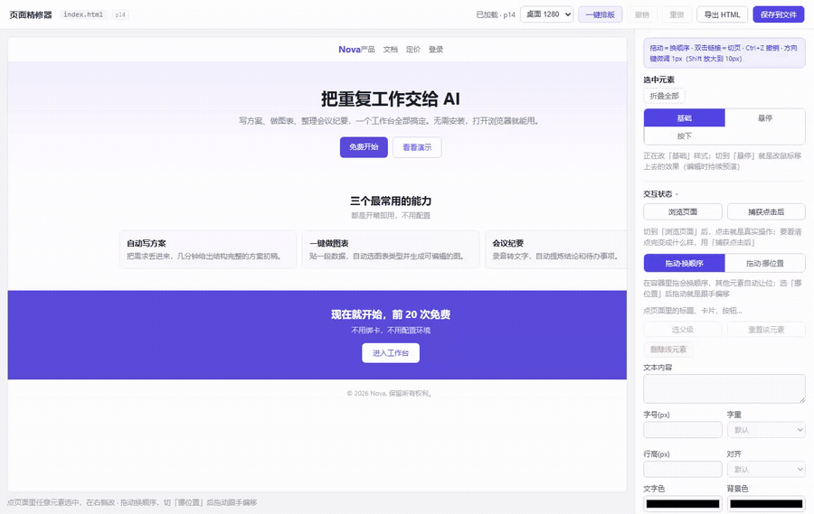

# 页面精修器 · page-tuner

**AI 生成页面 → 人按审美微调 → 改不动的交回给 AI。**

给 agent 用的本地 MCP + 给人用的可视化编辑器，两边改的是同一个单文件 HTML。不截图、不调视觉模型、不猜像素位置。



- 单文件静态 HTML，源码级局部替换，没碰到的字节一个不动
- 人：点选改样式 / 悬停·按下 / 拖顺序 / 一键排版 / 圈选一块写人话
- Agent：MCP 工具按 id 改样式、文字、插入、删除、调顺序
- 闭环：人的每次改动写进改动日志，圈选结果写进侧车 JSON；agent 先审日志、再读选区，改完自动同步回来

---

## 1. 目录结构

```
page-tuner/
├─ mcp_server.py        MCP 服务（stdio，纯标准库）：12 个工具
├─ htmlops.py           源码级手术：解析、局部替换、插入、删除、调顺序
├─ server.py            可视化编辑器后端（默认 8766）
├─ static/
│  ├─ index.html        编辑器界面
│  ├─ editor.js         面板逻辑、状态、同步、切页、折叠、改动日志
│  ├─ inject.js         注入到被编辑页面：选中、改样式、悬停预演、圈选
│  └─ style.css
├─ sample/landing.html  示例页面
├─ docs/                演示 GIF、博客
└─ mcp.example.json     MCP 客户端配置示例
```

依赖：Python 3.9+，**零第三方包**。Playwright 只用于跑测试，不是运行依赖。

---

## 2. 接入 MCP

把仓库放到任意位置，在客户端里加一条 stdio 配置（路径换成实际位置）：

```json
{
  "mcpServers": {
    "page-tuner": {
      "command": "python",
      "args": ["/abs/path/to/page-tuner/mcp_server.py"]
    }
  }
}
```

Claude Desktop（`claude_desktop_config.json`）、Cursor（`mcp.json`）、Trae、Cline 等通用。
Windows 路径写成 `"c:\\Users\\...\\page-tuner\\mcp_server.py"`，也可以直接抄 `mcp.example.json`。

### 作为 Agent Skill 使用

同一套流程也打包成了可移植的 Agent Skill：[`skill/page-tuner/SKILL.md`](skill/page-tuner/SKILL.md)。生成上架用的 zip：

```bash
python scripts/package_skill.py
```

打包与上架说明：[docs/skill-packaging.zh-CN.md](docs/skill-packaging.zh-CN.md)

---

## 3. 完整流程（agent 侧照这个走）

```
你写页面（HTML）
   │
   ├─ html_editor(start, file)         ← 起可视化编辑器，返回 url
   │     把 url 原样给人
   ▼
人：点选微调 / 悬停·按下 / 拖顺序 / 一键排版 / 圈选一块 + 写人话 + 选意图
   │     每一次改动写进 <page>.changes.json（防抖 400ms）
   │     点「存给 agent」→ 再写 <page>.selection.json
   ▼
你：html_changes(file)                 ← 先读人亲手改了什么（样式/文案/位置/删除/排版）
   │     对照源码审一遍：冲突、重复、误删 → 修正
   ├─ html_selection(file)             ← 再读 id、意图、原话
   │
   ├─ html_style / html_text / html_insert / html_delete / html_move
   │     改完自动同步回人的编辑器（1.2 秒内，选中和滚动都保留）
   ▼
人：继续微调 → 满意 → 保存 / 导出
   │
   └─ html_clean(file)                 ← 交付前清掉 data-ct-id
```

每一步都能独立用：不做可视化，纯 MCP 改代码也能跑通；不做 AI，纯编辑器也能改。

---

## 4. 工具清单

| 工具 | 用途 | 关键参数 |
|---|---|---|
| `html_editor` | 起/查/停本地编辑器 | `action: start\|status\|stop`、`file`、`port?` |
| `html_outline` | 看结构拿 id | `max_depth`、`limit` |
| `html_find` | 按标签 / 类名 / 文字定位 | `tag`、`cls`、`text` |
| `html_inspect` | 看单个元素详情（子元素、父级、开标签原文） | `id` |
| `html_style` | 改 inline 样式（可批量） | `ids[]`、`props{}` |
| `html_text` | 改叶子元素文字 | `id`、`text` |
| `html_move` | 同一父容器内调顺序 | `direction: up\|down\|before\|after` |
| `html_insert` | 插入新元素 | `id`、`position: before\|after\|inside`、`html` |
| `html_delete` | 删除元素（连整行缩进） | `id` |
| `html_clean` | 交付前清理内部标记 | `file` |
| `html_changes` | 读人在编辑器里亲手做的改动 | `file`、`clear?`、`limit?` |
| `html_selection` | 读人的圈选（id/意图/原话） | `file`、`clear?` |

规则：
- id 在会话里稳定，改完不用重新 `outline`
- 样式只覆盖传入的属性；`html_style` 里传空字符串表示删掉该属性
- 有子元素的容器不能改文字（会被拒绝并列子元素 id）
- 只能在同一个父容器内调顺序（跨容器会破坏样式继承，会被拒绝）
- MCP 没有浏览器，拿不到像素坐标；位置问题用间距 / 内边距 / 对齐解决
- 「整页一键排版」要读浏览器的计算样式，只在编辑器里由人点才准，MCP 不模拟

失败一律返回紧凑 JSON：`error` + `hint` + `near`，照着 hint 走即可。

---

## 5. 人在编辑器里能做什么

- 点选任意元素：字号 / 字重 / 行高 / 对齐 / 文字色 / 背景 / 圆角 / 内边距 / 宽度 / 透明度
- 状态：基础 / 悬停 / 按下（悬停编辑时持续预演，按下切浏览模式按住看真实效果）
- 预设：6 组渐变、5 档阴影、5 个悬停效果（上浮 / 放大 / 发光 / 变亮 / 清除）
- 拖动换顺序、拖动挪位置、方向键微调（Shift ×10）
- 一键排版：字号阶梯（0.85/1/1.2/1.5/2 倍基准）、行高 1.25/1.5、4px 间距网格、圆角取整
- 浏览页面：点击就是真实交互（加购、切页），蓝框隐藏，退出后选中恢复
- 捕获点击后：记录瞬时状态（文案 / 样式变化 + 回弹时间），摘要显示在面板里
- 圈选给 agent：拖框 → 选意图（改样式/改文案/加元素/整块交给你）→ 写人话 → 存给 agent
- 多页面：顶栏下拉切换同目录下的 html；选中站内链接可直接「去这一页」；双击链接切页
- 删除元素 / 重置元素 / 选父级 / 元素上下级 chip 一键跳转

保存与同步：
- 「保存到文件」把当前页面写回源码（自动剔除注入脚本、预览块、内部编号）
- agent 用 MCP 改了同一个文件，编辑器 1.2 秒内自动同步，选中和滚动位置保留
- 本地有没保存的改动时不自动覆盖，顶栏会亮「agent 改过文件，点这里同步」

---

## 6. 设计约定（想自己改源码时看）

- **两层样式**：几何（字号 / 行高 / 内边距 / 宽度 / 定位）走 inline；视觉（颜色 / 背景 / 渐变 / 透明度 / 阴影 / 圆角 / transform）走唯一类名 `.pt-N` + 注入的 `<style data-pt>` 块
- 写悬停 / 按下规则前会先把 inline 里的同名基础值搬进 base 规则再摘掉 inline，否则状态样式永远被压住
- 选择器用 `.pt-N.pt-N`（0,2,0）/ `.pt-N.pt-N:hover`（0,3,0），不用 `!important`
- 编辑时额外生成 `<style data-pt-preview>` 做悬停预演，保存 / 导出时剔除
- 选中用 `data-ct-id="eN"` 标记，交付前 `html_clean` 清掉
- 圈选结果落在 `<page>.selection.json`（侧车），MCP 读同一个文件；`clear: true` 读完就删
- 人的每次操作（改样式 / 尺寸 / 文案 / 挪位置 / 删除 / 重置 / 一键排版）都结构化成一条记录，防抖写进 `<page>.changes.json`；agent 用 `html_changes` 先审这些改动，再结合圈选意图动手
- 删掉界面上任何一个控件都不会让编辑器崩：事件绑定走容错 `on()`，字段回显走 `setVal` / `setText`，找不到元素就跳过
- `html_editor` 起的进程只由该 MCP 会话管理，`stop` 只关自己起的那个

---

## 7. 边界

- 只支持单文件静态 HTML（样式、脚本、图片都内联）。带构建产物的前端工程不在范围内
- 不支持自由拖动到任意坐标（文档流里拖动会塌陷）；需要位移用「挪位置」或间距
- 瞬时状态如果写死在页面 JS 里（改文案 + 定时器回弹），CSS 改不到，用圈选交给 agent 改源码
- 导出的 `blob:` 预览没有后端，要调接口的页面请在它自己的服务地址上看
- 编辑器只绑 `127.0.0.1`，不是公网服务；它只读写你打开的那一个 HTML 和它的侧车文件

---

## 8. 排错

| 现象 | 处理 |
|---|---|
| 编辑器打不开 / 空白 | 看顶栏 status；`python server.py <file> --port 8767` 换端口试 |
| 端口被占 | `html_editor` 会自动从 8766 往后找空端口；也可传 `port` |
| 改了页面没生效 | 确认点的是「保存到文件」；agent 改完看顶栏是否提示同步 |
| 找不到元素 id | `html_outline` 重新列一次；文件被外部改过时 id 会重排 |
| 编辑「编辑器自己」 | 预览里 iframe 会被暂停（about:blank），保存时自动还原，安全 |

---

## 9. 许可

MIT。博客：[让前端再死一次](docs/blog/why-frontend-dies.zh-CN.md)
